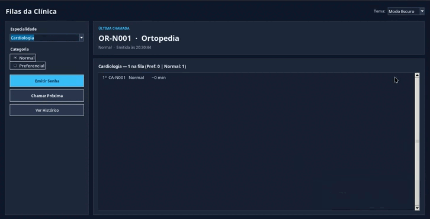

# 🏥 Sistema de Gerenciamento de Senhas – Clínica Médica



## 📌 Sobre o Projeto

O **Sistema de Gerenciamento de Senhas – Clínica Médica** é uma aplicação desenvolvida em Python com o objetivo de organizar e controlar o atendimento de pacientes em uma clínica médica.

O sistema permite a emissão de senhas de atendimento, separando os pacientes por especialidade médica e categoria de atendimento (preferencial ou normal).

A aplicação utiliza estruturas de filas para controlar a ordem dos atendimentos, garantindo prioridade aos pacientes preferenciais e respeitando a ordem de chegada dentro de cada categoria.

O projeto também possui uma interface gráfica desenvolvida com Tkinter, permitindo a interação do usuário com o sistema.

## 🎯 Objetivos

- Organizar o fluxo de atendimento dos pacientes.
- Separar as filas por especialidade médica.
- Garantir prioridade aos atendimentos preferenciais.
- Emitir senhas identificadoras para os pacientes.
- Estimar o tempo de espera.
- Registrar o histórico dos pacientes chamados.
- Facilitar o gerenciamento das filas de atendimento.

## ⚙️ Funcionalidades

### 1. Emissão de Senhas

O sistema permite emitir senhas automaticamente para os pacientes, identificando:

- Especialidade médica.
- Categoria de atendimento.
- Código da senha.
- Horário de emissão.

As senhas são geradas com uma identificação específica para cada especialidade e categoria.

**Exemplos:**

- `CG-P001` – Clínica Geral, Preferencial.
- `CA-N001` – Cardiologia, Normal.
- `OR-P001` – Ortopedia, Preferencial.

### 2. Especialidades Médicas

O sistema trabalha com três especialidades:

| Especialidade | Sigla |
|---|---|
| Clínica Geral | CG |
| Cardiologia | CA |
| Ortopedia | OR |

Cada especialidade possui suas próprias filas de atendimento.

### 3. Categorias de Atendimento

Os pacientes são divididos em duas categorias:

- **Preferencial:** possui prioridade no atendimento.
- **Normal:** segue a ordem de atendimento após os pacientes preferenciais.

O sistema utiliza a estrutura FIFO (First In, First Out), ou seja, o primeiro paciente que entra na fila é o primeiro a ser atendido dentro de sua categoria.

### 4. Estimativa de Tempo de Espera

O sistema calcula uma estimativa de espera considerando 30 minutos por paciente.

O cálculo leva em consideração a quantidade de pacientes que estão à frente na fila, respeitando a prioridade dos atendimentos preferenciais.

### 5. Chamada do Próximo Paciente

O sistema realiza a chamada automática do próximo paciente, seguindo as seguintes regras:

1. Verifica se existem pacientes na fila preferencial.
2. Caso existam, chama o primeiro paciente preferencial.
3. Caso não existam, chama o primeiro paciente da fila normal.
4. Se ambas estiverem vazias, apresenta uma mensagem de erro.

### 6. Visualização das Filas

Permite consultar a situação das filas de cada especialidade, apresentando:

- Quantidade total de pacientes.
- Quantidade de pacientes preferenciais.
- Quantidade de pacientes normais.
- Lista de senhas aguardando atendimento.

### 7. Histórico de Atendimentos

O sistema mantém um histórico das senhas chamadas, permitindo consultar os atendimentos realizados durante a execução da aplicação.

### 8. Tratamento de Erros

Foi criada a exceção personalizada `ErroFila`, utilizada para tratar situações como:

- Especialidade inválida.
- Categoria de atendimento inválida.
- Tentativa de chamar um paciente quando a fila está vazia.

## 🛠️ Tecnologias Utilizadas

O projeto foi desenvolvido utilizando:

- **Python:** linguagem de programação utilizada no desenvolvimento da aplicação.
- **Collections (deque):** estrutura utilizada para implementar as filas de atendimento.
- **Datetime:** utilizada para registrar o horário de emissão das senhas.
- **Tkinter:** biblioteca utilizada para desenvolver a interface gráfica.
- **Messagebox:** utilizada para apresentar mensagens ao usuário.
- **TTK:** biblioteca complementar para componentes gráficos.

## 🧱 Estrutura do Código

O projeto está organizado em classes, cada uma com sua responsabilidade.

### Classe `ErroFila`

Responsável por representar os erros específicos relacionados ao gerenciamento das filas.

### Classe `Senha`

Responsável por armazenar os dados de cada senha emitida:

- Código identificador.
- Especialidade médica.
- Categoria de atendimento.
- Horário de emissão.

### Classe `GerenciadorFilas`

Responsável pelas principais regras de negócio do sistema:

- Criar e organizar as filas.
- Validar especialidades e categorias.
- Gerar códigos de senhas.
- Calcular o tempo estimado de espera.
- Emitir senhas.
- Chamar os próximos pacientes.
- Consultar as filas.
- Registrar o histórico de chamadas.

### Classe `ClinicaApp`

Responsável pela interface gráfica da aplicação, desenvolvida com Tkinter, permitindo a interação do usuário com o sistema.

## 📂 Estrutura do Projeto

```text
Sistema-Gerenciamento-Senhas/
│
├── filas.py
├── main.py
├── tela.py
├── README.md
└── .gitignore
```

### Descrição dos arquivos

- **filas.py:** contém a lógica de gerenciamento das filas de atendimento, incluindo emissão de senhas, controle de prioridade, cálculo do tempo de espera, chamada de pacientes e histórico de atendimentos.

- **main.py:** responsável por iniciar a aplicação e executar o sistema.

- **tela.py:** contém a implementação da interface gráfica, desenvolvida com Tkinter, permitindo a interação do usuário com o sistema.

- **README.md:** documentação do projeto, apresentando seus objetivos, funcionalidades, tecnologias utilizadas e instruções de execução.

- **.gitignore:** define os arquivos e diretórios que devem ser ignorados pelo Git, evitando o envio de arquivos temporários, ambientes virtuais e outros arquivos desnecessários ao repositório.

## ▶️ Como Executar o Projeto

### Pré-requisitos

- Python 3 instalado.
- Tkinter disponível na instalação do Python.

### Passo 1 – Clonar o repositório

```bash
git clone URL_DO_REPOSITORIO
```

### Passo 2 – Acessar a pasta do projeto

```bash
cd Sistema-Gerenciamento-Senhas
```

### Passo 3 – Executar a aplicação

```bash
python main.py
```

No Windows, também é possível utilizar:

```bash
py main.py
```

## 🧪 Testes

O código possui exemplos de testes para verificar o funcionamento do gerenciamento de filas.

Os testes verificam:

- Emissão de senhas normais.
- Emissão de senhas preferenciais.
- Prioridade dos pacientes preferenciais.
- Ordem de atendimento dentro das categorias.
- Comportamento do sistema quando a fila está vazia.

## 🚧 Status do Projeto

**Em desenvolvimento.**

O gerenciamento das filas possui funcionalidades implementadas, incluindo emissão de senhas, prioridade de atendimento, estimativa de espera e histórico de chamadas.

A interface gráfica possui sua estrutura inicial implementada e está em processo de desenvolvimento e integração com as funcionalidades do gerenciador de filas.

## 👨‍💻 Considerações Finais

O projeto tem como finalidade aplicar conceitos de programação, estruturas de dados, orientação a objetos, tratamento de exceções e desenvolvimento de interfaces gráficas.

A utilização de filas permite organizar os atendimentos de maneira estruturada, contribuindo para um fluxo de atendimento mais organizado e eficiente em uma clínica médica.

